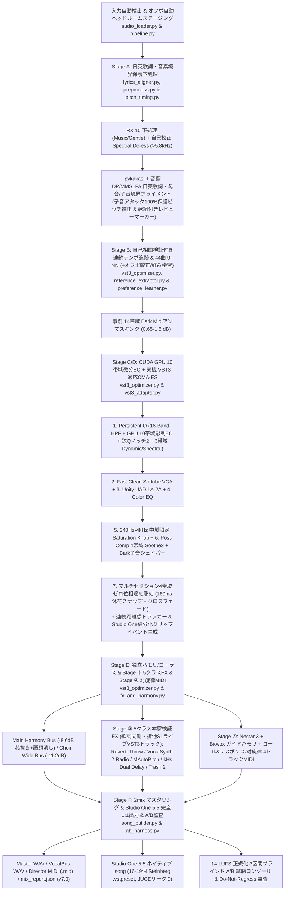

# MIX Automation v7.0 — システムアーキテクチャ設計書

## 1. コア設計思想

本エンジンは、特定楽曲への過学習（対症療法）を排し、**「楽曲・録音レベル非依存の対オケ相対音響プロファイル」**、**「CUDA GPU 微分可能最適化＋マルチセクション適応 DSP」**、および**「実機商用 VST3 プラグイン＋Studio One 5.5 への動的・特殊演出まで含めた 1:1 ネイティブ書き出し」**を軸に設計されている。

- **相対音響目標＋オフボ較正＋個人審美学習**: `BS-RoFormer` 分離＋公式オフボ 44 曲較正済みデータベースから距離重み付き 9-NN で連続ターゲットを合成し、分離バイアス逆算補正・梓川テイスト 25% ブレンド・Studio One 手直し履歴（`user_preference_offsets.json`）を統合する。
- **オフボ＆ボーカル双方の無歪みヘッドルームステージング**: ボーカルの `-18 LUFS` ステージングに加え、`-36 LUFS` 等の未マスタリング極小音量オフボや過大オフボをトゥルーピーク保護付きで標準ミキシングレンジ（`-16 LUFS` 付近）へ自動ステージングし、あらゆる配布素材でコンプ閾値とフェーダーが最適動作域に入ることを物理保証する。
- **決定論的 DSP 最適化と演出／ディレクションの分離**: 0.1 dB / ms 精度のミキシング基盤は PyTorch GPU 微分可能最適化＋CMA-ES で決定論的に計算し、Stage ③ 5 クラス演出・Stage ④ 対旋律 MIDI 提案を上位層として統合する。

---

## 2. v7.0 エンドツーエンド信号フロー

---

## 3. v7.0 新規・拡張技術要素

### 3.1 CUDA GPU 10 帯域微分彫刻 EQ ＆ マルチセクションゼロ位相適応彫刻
- 桁落ちのない $\sin^2(\omega/2)$ 定式化によるバッチ化 RBJ バイクワッドを RTX 5060 Ti（CUDA）上で高速最適化し、`z_db.detach()` と `cur_core_margin.detach()` で中低域スクープを構造的に防止する。
- さらに基準サビ以外の各セクション（`"Quiet_Breakdown"`, `"Verse_PreChorus"`, `"Other_Chorus"`）に対し、局所相対プロファイルから 4 帯域（`220 Hz`, `520 Hz`, `2600 Hz`, `6500 Hz`、高域は `<= 0.0 dB` 厳守）の微分トーン補正を算出し、歌唱の谷（休符・ディップ）にスナップした 180ms コサインクロスフェードで滑らかに適応させる。

### 3.2 日英歌詞・音素境界アライメントと Studio One 完全 1:1 動的・演出再現
- `lyrics_aligner.py` が `pykakasi` で漢字かな＋英語混在歌詞 `.txt` をモーラ展開し、母音コア（`180–3600 Hz`）と子音アタック保護マスク（`4.8–11 kHz` 歯擦音＋`1.8–5.5 kHz` 破裂音オンセット）を分離する。
- Studio One 書き出し時の `02_mainvocal_prepared.wav` にも Bark 子音シェイパーを 1:1 適用し、インライン Stage ③ FX（`radio_voice`, `distortion_grit`, `hard_autotune`）が存在する秒数区間は優先度排他マスクでメイン側を 40ms ダックすると同時に、ドライスライス＋真正 Steinberg `.vstpreset` インサート付きの専用スポットトラックを配置することで、Studio One 5 上でそのままライブ VST3 再生・ノブ微調整を可能にした。

---

## 4. モジュール構成

| パス | 責務 |
| :--- | :--- |
| `src/mix_automation/cli.py` | Typer CLI（`mix`, `build-references`, `scan-references`, `learn-preferences`, `propagate-anchor`, `benchmark-ab`, `doctor`, `inspect-plugin`, `analyze-pair`, `inspect-song`） |
| `src/mix_automation/pipeline.py` | v7 全工程オーケストレーション、オフボ自動ステージング、排他 FX スライス、レポート出力 |
| `src/mix_automation/analysis/relative_profile.py` | 相対音響プロファイル計算、アーキタイプ分類、アンカー伝播数理モデル |
| `src/mix_automation/analysis/reference_extractor.py` | `BS-RoFormer` 分離、44 曲オフボ較正フィードバック、9-NN 合成、`youtube_references` 4 段階品質ゲート |
| `src/mix_automation/analysis/preference_learner.py` | Studio One `.song` 差分解析（フェーダー・センド・クリップ・`Persistent Q`）、EMA 好み学習、高度アンカー伝播 |
| `src/mix_automation/analysis/ab_harness.py` | `-14 LUFS` 正規化 3 区間 A/B 抽出、Do-Not-Regress 自動監査、ブラインド X/Y HTML コンソール生成 |
| `src/mix_automation/config/plugin_registry.py` | ローカル検証済み 27 VST3 プラグインカタログ・監査 |
| `src/mix_automation/dsp/lyrics_aligner.py` | 日英歌詞パース（`pykakasi`）、母音／子音境界マスク、音響 DP＋`torchaudio` `MMS_FA` アライメント |
| `src/mix_automation/dsp/preprocess.py` | `RX 10` 下処理、音節ラウドネス均し、自己校正 Spectral De-ess |
| `src/mix_automation/dsp/pitch_timing.py` | 音素保護型ピッチ／タイミング微補正、生歌補正定量ベンチマーク、歌詞付きレビューマーカー |
| `src/mix_automation/dsp/vst3_adapter.py` | Unicode 正規化・型強制・読み戻し検証付き VST3 アダプタ（`Persistent Q`, `Soothe2`, `LA-2A`, `VocalSynth 2`, `MAutoPitch`, `kHs Dual Delay`, `Trash 2` 等） |
| `src/mix_automation/dsp/vst3_optimizer.py` | CUDA GPU 微分 EQ、マルチセクション適応彫刻、連続テンポ追跡、CMA-ES、Bark アンマスキング、ハモリ／コーラスバス |
| `src/mix_automation/creative/fx_and_harmony.py` | 本家 5 クラス FX 検出・適用、`Nectar 3` ハモリ、コール＆レスポンス／対旋律提案＆4 トラック MIDI 出力 |
| `src/mix_automation/io/audio_loader.py` | ステム探索・分類（階層／フラット両対応）・重複排除・チャンネル正規化 |
| `src/mix_automation/io/song_builder.py` / `studio_one.py` | Studio One 5.5 ネイティブ `.song`・Steinberg `.vstpreset`・`.envelopex`・スポット FX トラック・可変 `TempoMap` 生成 |
