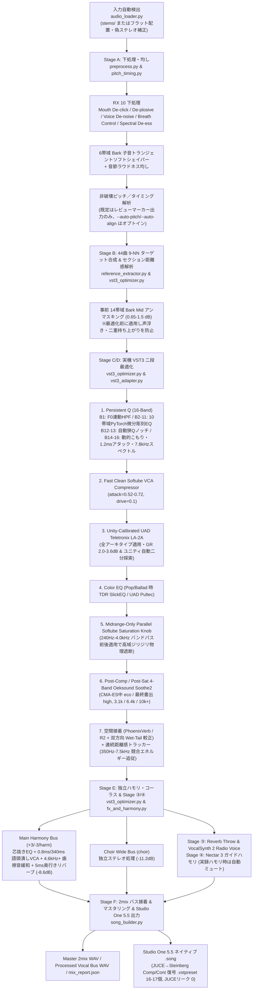

# MIX Automation v6.0 — システムアーキテクチャ設計書

## 1. コア設計思想

本エンジンは、特定楽曲への過学習（対症療法）を排し、**「楽曲非依存の対オケ相対音響プロファイル（Relative Vocal-to-Instrumental Profile）」**と**「実機商用 VST3 プラグインの数理最適化＋Studio One 5.5 への 1:1 ネイティブ書き出し」**を軸に設計されている。

- **相対音響目標の定式化**: 絶対音圧や固定 EQ カーブではなく、`BS-RoFormer` で分離し公式オフボで較正した 44 曲の上級者リファレンスから、K-LUFS 比・Mid K-LUFS 比・部分ラウドネス余裕・7 帯域固有声質プロファイル・7 帯域対オケマージン・クレストファクター差・位置安定度・`Wet-Tail`（空間余韻比）・`Side/Mid` 幅を抽出する。
- **連続 9-NN 音響ターゲット合成＋テイストブレンド**: 対象曲のオケ音響記述子と歌唱 F0 中央値に基づき、44 曲から距離重み付き 9-NN で連続ターゲットを合成する。既定では `--taste azusagawa --taste-weight 0.25` により 75% 汎用 9-NN＋25% 梓川テイストをブレンドする。
- **決定論的 DSP 最適化と演出／ディレクションの分離**: 0.1 dB / ms 精度のミキシング基盤は PyTorch 微分可能最適化＋CMA-ES で決定論的に計算し、演出・ハモリ・重み調整を上位層に分離する。

---

## 2. v6.0 エンドツーエンド信号フロー

---

## 3. 主要技術要素の詳細

### 3.1 16 バンド超高精細 `Persistent Q` と `z_db.detach()` 中低域保護

- **Band 1**: 歌唱 F0 中央値に連動する安全 HPF。
- **Bands 2–11**: 10 帯域 ERB／オクターブ間隔の PyTorch 微分可能 EQ。44 曲の**固有声質プロファイル（`vocal_intrinsic_bands_db`）**と対象曲の**レベル不変なオケ補完マージン（`band_margins_db`）**を同時に最適化する。高域帯（`sibilance` / `air_sheen`）の損失計算時に `z_db.detach()` と `cur_core_margin.detach()` を噛ませることで、高域目標への収束が中低域の芯を誤ってスクープする勾配リークを構造的に遮断している。
- **Bands 12–13**: 歌唱中の定常共鳴ピークを自動検出し、`Q=6.5–7.2` の狭帯域ノッチを 2 本配置する。
- **Bands 14–16**: `Persistent Q` の実時間ダイナミック／スペクトル機能を活用し、Band 14 で `290 Hz` 付近の近接こもり、Band 15 で `1.2 ms` 超高速アタックによる `3.25 kHz` 突き刺さり、Band 16 で `7.8 kHz` 高域ジリつきを動的制御する。

### 3.2 事前アンマスキング＆連続距離感トラッカー

- 14 帯域 Bark 適応 Mid アンマスキング（`0.65–1.5 dB`）を Stage D の CMA-ES 最適化**より前**にオフボーカルへ適用する。これにより最適化後にオケを削ってボーカルが浮き上がる「二重持ち上がり」を根絶した。
- 連続距離感トラッカー（`compute_continuous_distance_envelopes`）は広帯域 RMS ではなく `350 Hz–7.5 kHz` のボーカル競合帯域エネルギーを連続監視する。サブベースだけが残る静寂ドロップ（例：`シックスフィートアンダー` 2:15 付近）でも正確に距離変化を検知し、ゲイン・パラレルサチュレーション量・高域の柔らかさ・空間量を滑らかに追従させる。

### 3.3 デュアル・ハモリ／コーラス分離アーキテクチャ

- `audio_loader.py` がファイル名規則からメインハモリ（`+3`, `-3`, `harm` 等）とコーラス（`choir` 等）を明確に分離し、モノラル素材の偽ステレオ書き出しも自動補正する（モノラルハモリ 1 本のみの場合は対称 `11 ms` Haas で自然なステレオ広がりを付与）。
- メインハモリはリードのフォルマント中心周波数に連動した「芯抜き EQ」（`-4.4 dB @ lead_core_hz`, `-3.8 dB @ 2.85 kHz`）、`0.8 ms` 超高速アタック＋`340 ms` 低速リリース・`6.5:1` の「語頭潰しコンプ」、`4.6 kHz+` 歯擦音抑制、`5 ms` 短プリディレイのリバーブ＋`19/29 ms` 拡散ディレイでリードの背後へ立体分離させつつ、真ステレオ K-LUFS `-8.6 dB` で明瞭に聴こえる位置へ収める。コーラスは独立した `choir_wide_bus` として `-11.2 dB` で処理される。

---

## 4. モジュール構成

| パス | 責務 |
| :--- | :--- |
| `src/mix_automation/cli.py` | Typer CLI エントリポイント（`mix`, `build-references`, `propagate-anchor`, `doctor`, `inspect-plugin`, `analyze-pair`, `inspect-song`） |
| `src/mix_automation/pipeline.py` | v6 全工程オーケストレーション、スタイル解決、アンカー伝播、レポート出力 |
| `src/mix_automation/analysis/relative_profile.py` | 相対音響プロファイル計算、アーキタイプ分類、アンカー伝播数理モデル |
| `src/mix_automation/analysis/reference_extractor.py` | `BS-RoFormer` 音源分離、44 曲オフボ較正、9-NN ターゲット合成 |
| `src/mix_automation/config/plugin_registry.py` | ローカル検証済み 27 VST3 プラグインカタログ・監査 |
| `src/mix_automation/dsp/preprocess.py` | `RX 10` 下処理、音節ラウドネス均し、6 帯域 Bark 子音ソフトシェイパー |
| `src/mix_automation/dsp/pitch_timing.py` | 非破壊ピッチ／タイミング解析、レビューマーカー、オプトイン補正 |
| `src/mix_automation/dsp/vst3_adapter.py` | 型強制・読み戻し検証付き VST3 アダプタ（16 バンド `Persistent Q`, `Soothe2`, `LA-2A`, `VocalSynth 2` 等） |
| `src/mix_automation/dsp/vst3_optimizer.py` | 微分彫刻 EQ、自動ノッチ、CMA-ES 実 VST3 最適化、Bark アンマスキング、距離感トラッカー、ハモリ／コーラスバス |
| `src/mix_automation/creative/fx_and_harmony.py` | 本家 FX 検出、`VocalSynth 2` ラジオ・Biovox 適用、`Nectar 3` ガイドハモリ生成 |
| `src/mix_automation/io/audio_loader.py` | ステム探索・分類（階層／フラット両対応）・チャンネル正規化 |
| `src/mix_automation/io/song_builder.py` | Studio One 5.5 ネイティブ `.song`・Steinberg `.vstpreset` 生成（JUCE Base64 復号） |
| `src/mix_automation/io/studio_one.py` | `.song` アーカイブ検査、VST3 `moduleinfo` CID 抽出 |

---

## 5. 統合・参考にした GitHub OSS アセット

- **[spotify/pedalboard](https://github.com/spotify/pedalboard)**: 実機 VST3 ホスティング、高速レンダリング、`raw_state` 取得。
- **[nomadkaraoke/python-audio-separator](https://github.com/nomadkaraoke/python-audio-separator)**: `BS-RoFormer` (`model_bs_roformer_ep_317_sdr_12.9755.ckpt`) によるリファレンス音源分離。
- **[csteinmetz1/dasp-pytorch](https://github.com/csteinmetz1/dasp-pytorch)** / **[SonyResearch/diffvox](https://github.com/SonyResearch/diffvox)**: 微分可能 DSP 最適化の設計基盤。
- **[legsmechanical/bark-transient-shaper](https://github.com/legsmechanical/bark-transient-shaper)**: 6 帯域 Bark 子音トランジェントソフトシェイパーの着想元。
- **次期導入候補として調査済み**: **[qiuqiao/SOFA](https://github.com/qiuqiao/SOFA)**（日英歌唱音素アライナー）、**[CPJKU/beat_this](https://github.com/CPJKU/beat_this)** / **BeatNet**（連続テンポ・拍追跡）、**[mhrice/RemFx](https://github.com/mhrice/RemFx)**（FX 分類・検出）。
